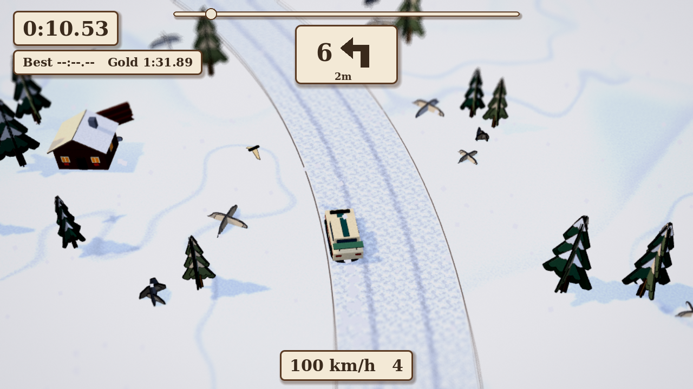
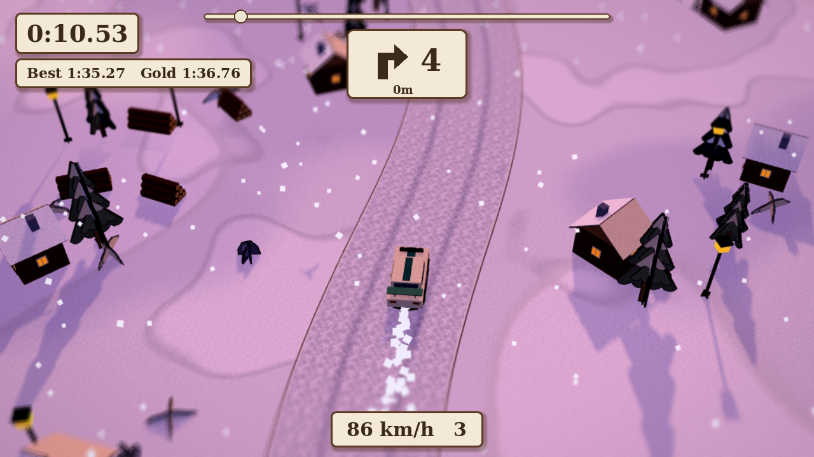

# Paper Rally

A landscape Android rally game in a handcrafted pop-up papercraft style, built with **Godot 4.4**
(GL Compatibility renderer, so it runs on almost any Android phone or tablet).

Every object is cut, folded and slotted card. Each piece is a thick slab with a printed dark cut edge, a
pale lip on its light-facing edges, kraft-tinted backs and layered collage prints. The lighting is matte,
wrap-lit paper with shadows tinted by the world's colour, never grey. A tilt-shift "macro lens" makes the
stages look like a miniature diorama. The look follows the
[papercraft skill](https://github.com/xikhar/papercraft), ported from its three.js reference to Godot.
The skill's own `engines.md` notes call the Godot port untested, so it was tuned here from rendered
screenshots.

## Screenshots

| Dry: Meadow Run | Rain: Harbour Lanes (Race vs AI) |
|---|---|
|  |  |
| **Snow: Alpine Pass** | **Snow at dusk: Twilight Taiga** |
|  |  |
| **Title (live diorama behind the menu)** | **Settings: presets, individual options, pop-up toggle** |
|  |  |

## Features

| | |
|---|---|
| **Game modes** | **Time Trial** (best times, gold/silver/bronze medals), **Championship** (4 series of AI-contested stages with points: 10-8-6-4-2-1), **Race vs AI** (head-to-head on one stage, 3 or 5 opponents) |
| **Stages** | 9 procedurally generated point-to-point stages: 3 dry (Meadow Run, Sandstone Canyon, Autumn Ridge), 3 rain (Moorland Mire, Pinewood Deluge, Harbour Lanes), 3 snow (Alpine Pass, Frozen Lakes, Twilight Taiga). Each one has its own palette, scenery set, light set and grip |
| **Weather** | Rain: wet roads, puddles that splash and drag, paper rain streaks, about 72 % grip. Snow: paper snowflakes, cold lilac shadows, 49-56 % grip. Dry: dust trails |
| **Cars** | 6 cars with different speed, acceleration, grip and handling: Pip 1300, Kestrel GT, Badger 4x4, Marten RS, Lynx Turbo, Otter Estate |
| **Co-driver** | Pace-note cards for each upcoming bend (direction, severity 1-6, hairpins) |
| **Controllers** | Any Bluetooth or USB-C game controller (Xbox, PlayStation, 8BitDo and similar), with analog steering and triggers. All menus can be driven from the controller |
| **Touch** | On-screen paper buttons or tilt steering. They hide automatically when a controller is connected |
| **Haptics** | Controller rumble for road texture, sliding, off-road, gear shifts, impacts, puddles, the countdown and the finish. Short, rate-limited phone vibration when no controller is connected. Strength slider and on/off toggles |
| **Graphics settings** | Low / Medium / High presets plus individual options: render resolution, shadows, tilt-shift blur, MSAA, scenery density, draw distance, weather particles, paper fibre detail, 30/60 fps cap, FPS counter |
| **Pop-up toggle** | *Settings → Graphics → Pop-up scenery animation*. **On**: scenery lies folded flat and springs up on a paper-flap spring as you approach, then folds away behind you. **Off**: the same paper scenery stands still and is batched into chunked MultiMeshes (far fewer draw calls). Switch it mid-race from the pause menu to compare |

## Controls

| Action | Controller | Keyboard | Touch |
|---|---|---|---|
| Accelerate | RT / A | W / Up | GAS |
| Brake / reverse | LT / X | S / Down | BRAKE |
| Steer | Left stick / D-pad | A D / Left Right | `<` `>` buttons or tilt |
| Handbrake | B / RB | Space | HAND |
| Reset to road | Y | R | |
| Camera (chase / high) | Back / LB | C | |
| Pause | Start | Esc / P | II |
| Settings tabs | LB / RB | Q / E | tap |

## Building the APK

The repository holds only source; Godot imports everything on first open.

1. Install **Godot 4.4.1** and its export templates (Editor → Manage Export Templates).
2. Install **JDK 17+** and the **Android SDK** (platform-tools, build-tools 34, platform 34), and point
   Godot at them: *Editor Settings → Export → Android*.
3. Open the project and use *Project → Export → Android*, or run:
   ```bash
   godot --headless --path . --export-debug "Android" build/PaperRally-debug.apk
   ```
   Debug builds use Godot's debug keystore. For a release build, set a release keystore in the export
   preset (or the `GODOT_ANDROID_KEYSTORE_RELEASE_*` environment variables) and use `--export-release`.
4. Install the APK on a phone: `adb install -r build/PaperRally-debug.apk`, or copy it over and open it.

The export preset (`export_presets.cfg`) targets arm64-v8a and armeabi-v7a. It requests the `VIBRATE`
permission, runs in immersive landscape (either way up) and uses the Compatibility (OpenGL ES 3) renderer.

## Project layout

```
project.godot, export_presets.cfg, icon.svg
scenes/main.tscn            entry scene (everything else is built in code)
scripts/main.gd             menus, pause, results, championship flow, post-process lens
scripts/autoload/           Settings (presets + input map), Game (state + saves), Haptics, Sfx (procedural audio)
scripts/data/catalog.gd     cars, light/weather sets, stages, championship series
scripts/paper/paper_kit.gd  card builder: thickness, cut edge, lit lip, kraft backs, folded boxes
scripts/paper/pieces.gd     scenery kit: pines, trees, birches, rocks, mesas, cacti, houses, barns, cabins, bales, ...
scripts/paper/flap_spring.gd  the papercraft skill's latched paper-flap spring (rise, overshoot, 4.5 Hz quiver, soft fall)
scripts/world/track.gd      seeded stage generator, projection queries, pace notes, ideal-speed profile
scripts/world/scenery.gd    clustered placement; pop-up (animated) vs batched (static) scenery
scripts/world/stage.gd      lights, ground, road, gantries, puddles, rain/snow particles, birds
scripts/car/                paper car model, arcade rally physics, AI driver, player input
scripts/race/               race controller (fixed 120 Hz physics, collisions, timing), chase camera
scripts/ui/                 paper UI theme, HUD with pace notes, touch controls
shaders/                    paper.gdshader, ground, road, post (tilt-shift + grade)
```

No image or audio files are shipped. Card prints, ground washes and fibre are procedural, and every sound
(engine, paper flaps, splashes, skids, rain and wind) is synthesised at start-up.

## Notes on performance

- On mid-range phones, start with the **Medium** preset. On low-end devices, use **Low**: it turns off
  shadows and tilt-shift, renders at 60 % resolution and thins the scenery.
- Turning the pop-up animation **off** batches all scenery into MultiMeshes, so there are far fewer draw
  calls. When it is **on**, pieces are hidden while they lie folded flat, and only pieces near the car
  are animated.
- The FPS counter (*Settings → Graphics*) helps when comparing settings on a device.
