# Paper Rally

A landscape Android rally game in a handcrafted pop-up papercraft style, built with **Godot 4.4**
(GL Compatibility renderer, so it runs on almost any Android phone or tablet).

Every object is cut, folded and slotted card. Each piece is a thick slab with a printed dark cut edge, a
pale lip on its light-facing edges, kraft-tinted backs and layered collage prints. The lighting is matte,
wrap-lit paper with shadows tinted by the world's colour, never grey. A tilt-shift "macro lens" makes the
stages look like a miniature diorama. The look follows the
[papercraft skill](https://github.com/xikhar/papercraft), ported from its three.js reference to Godot.
The skill's own `engines.md` notes call the Godot port untested, so it was tuned here from rendered
screenshots.

## Screenshots

| Dry: Meadow Run | Rain: Harbour Lanes (Race vs AI) |
|---|---|
| 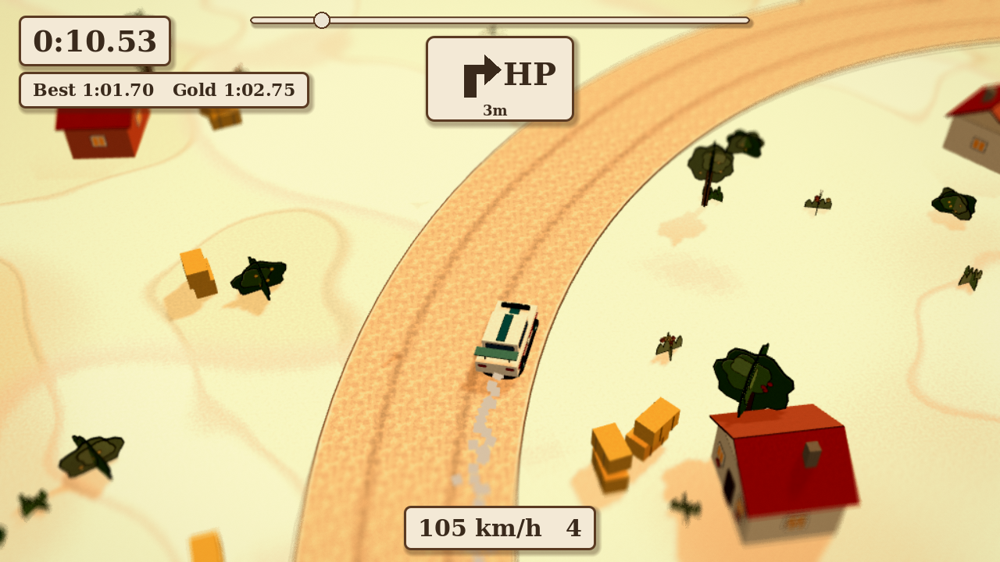 | 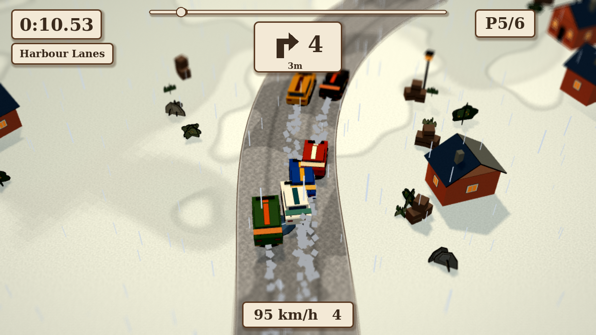 |
| **Snow: Alpine Pass** | **Snow at dusk: Twilight Taiga** |
|  |  |
| **Jump with taped-off crowd** | **Water splash in Race vs AI** |
| 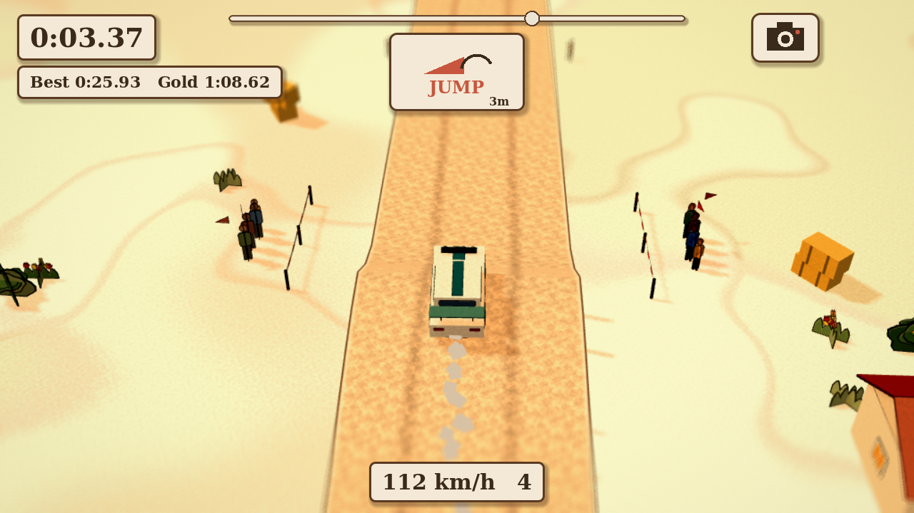 | 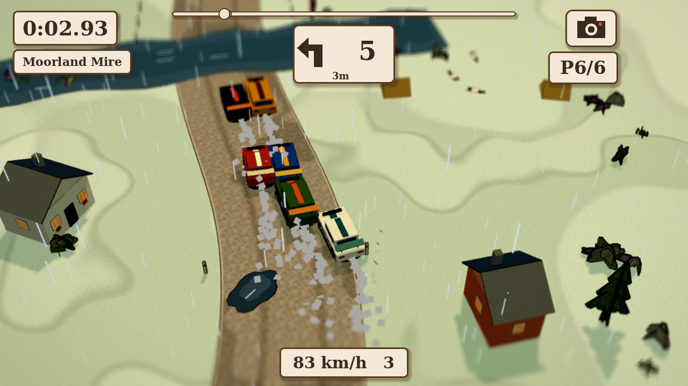 |
| **Night: headlights cast light and shadow** | **All 15 cars** |
| 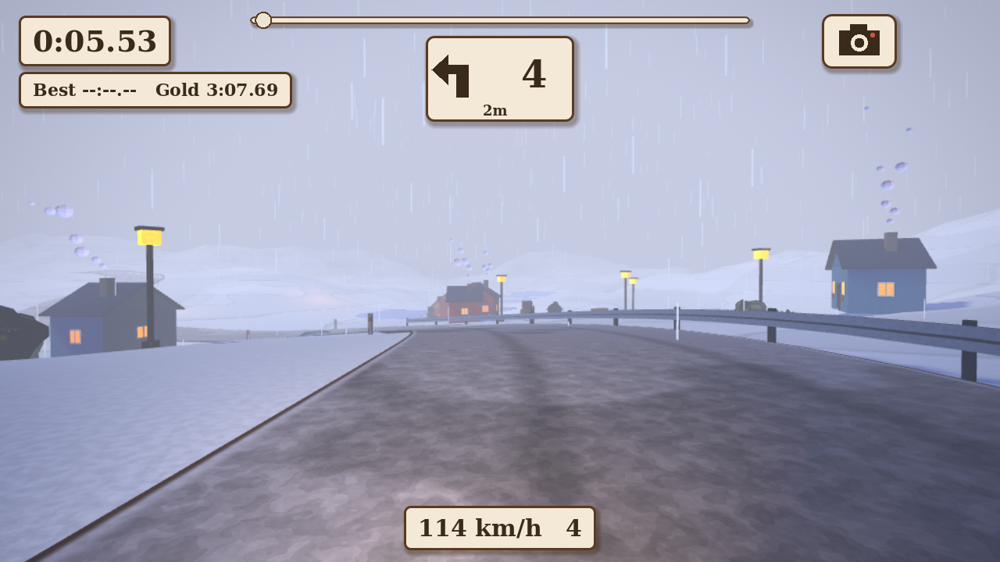 | 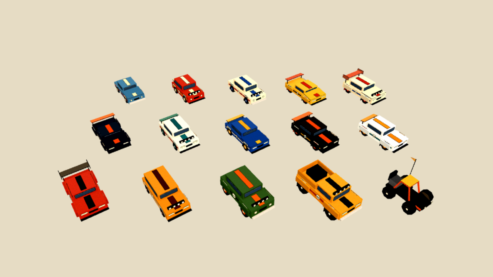 |
| **Cockpit view** | **Hills and stacked-card contours** |
| 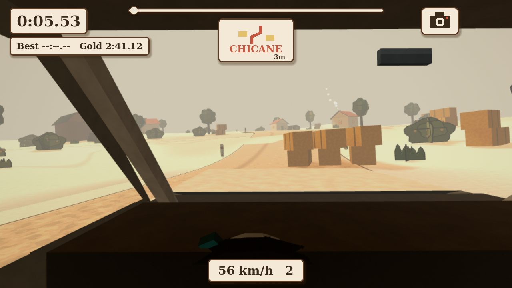 | 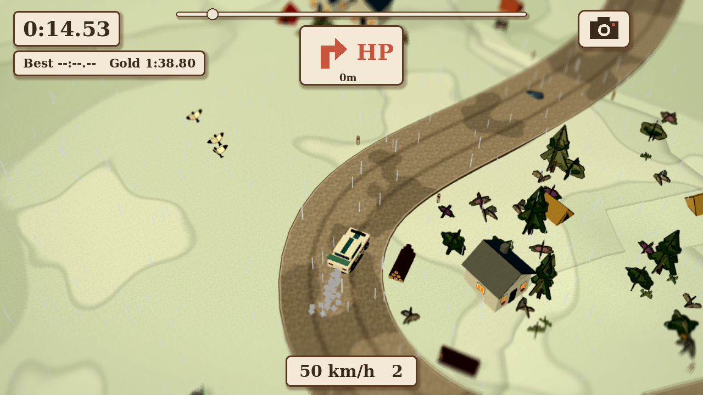 |
| **Bonnet view: Alpine climb** | **High overhead view** |
| 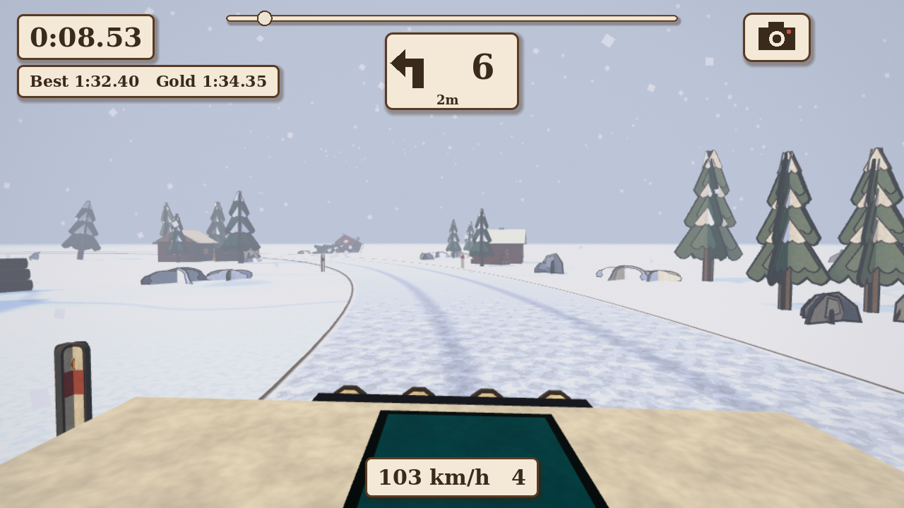 | 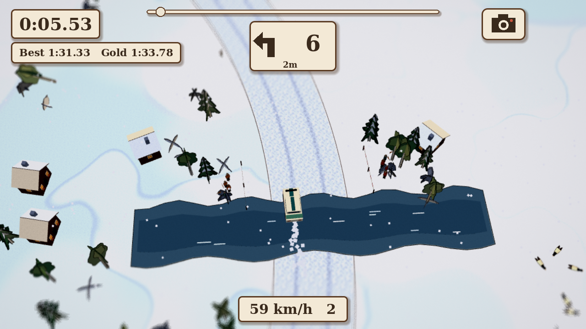 |
| **Title (live diorama behind the menu)** | **Settings: presets, individual options, pop-up toggle** |
| 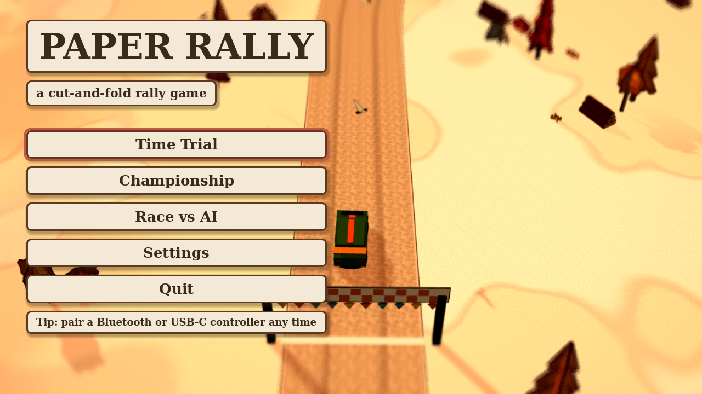 | 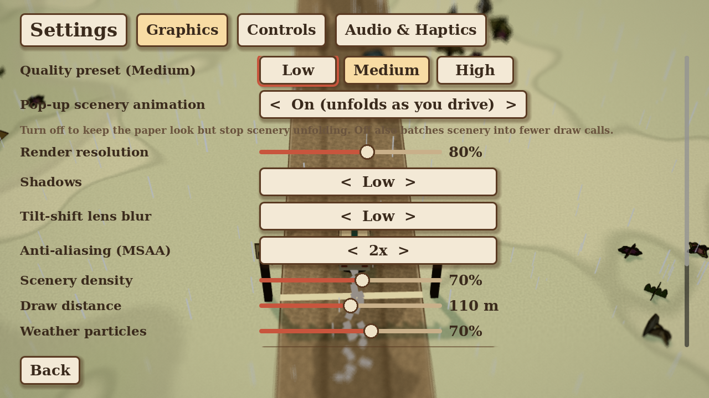 |

## Features

| | |
|---|---|
| **Game modes** | **Time Trial** (best times, gold/silver/bronze medals and a ghost of your best run), **Championship** (6 series with points 10-8-6-4-2-1, including the always-at-night **Night Rally**), **Race vs AI** (head-to-head on one stage, 3 or 5 opponents) |
| **Stages** | 40 procedurally generated point-to-point stages: 10 locations, each as a **Sprint (4 km)**, **Classic (8 km)**, **Long (10 km)** and **Marathon (15 km)**. Layouts are pre-generated and ship with the game, and scenery streams in around the camera so long stages stay smooth. Some locations have **Armco barriers** (outside of fast bends, mountain roads) or **post-and-rail fencing** (farmland, moors), and both act as solid walls. Dry: Meadow Run, Sandstone Canyon, Autumn Ridge. Rain: Moorland Mire, Pinewood Deluge, Harbour Lanes. Snow: Alpine Pass, Frozen Lakes, Twilight Taiga. Coast: **Coastal Cliffs** (clifftop lanes with a sheer drop to the sea, Armco along the edge, lighthouses and boats; running off the cliff puts you back on the road) and **Harbour Lanes** (shoreline, beaches, stone quays and moored fishing boats). The stage select screen shows a preview picture of every location |
| **Woodland** | Pinewood Deluge, Autumn Ridge and Twilight Taiga are dense forest stages: walls of trees in bands either side of the road, thinning with distance and broken by the odd clearing, in contrast with the open meadows, moors, lakes and clifftops |
| **Dry-stone walls** | Meadow Run, Moorland Mire, Harbour Lanes and Coastal Cliffs have stretches of rough British field walls with upright coping stones. They are solid, like Armco and fences |
| **Autumn leaves** | Dry leaves gust and tumble across the road on Autumn Ridge |
| **Car lights** | Brake lights glow red and wash the road behind when you brake; white reversing lights come on in reverse |
| **Loading screen** | A static card with the location's picture, stage name, length, weather, time of day, game mode and a driving tip |
| **Bridges** | English stone humpback arch bridges (Meadow Run, Autumn Ridge, Moorland Mire) and covered wooden bridges (Autumn Ridge, Pinewood Deluge) over rivers cut into the landscape. Their parapets and walls are solid |
| **Parc fermé** | The road carries on past the flying finish into a parc fermé: a gravel lot with marked bays, service gazebos and vans, a PARC FERMÉ gantry and spectators. Every car, yours included, rolls in and parks in its own bay before the results appear |
| **Altitude** | Every stage climbs, dips and rolls. A road altitude profile (overall climb, rolling undulation, maximum grade) and a landscape heightfield blend into each other. Hills, ridges and valleys rise and fall beside the road, drawn as stacked card contours. Climbs cost speed and descents add it, and crests can lift the car off the ground. Each location's layout and altitude are modelled on a real rally region: British farm lanes, Mexico / Acropolis mountain switchbacks, German vineyard ridges, Welsh moors, fast Finnish forest crests, Corsican coastal climbs, the Monte Carlo Col de Turini hairpin climb, the Swedish frozen lakes, Arctic forest |
| **Time of day** | Day, Dusk or Night for any stage. At dusk and night every car's twin dipped headlights light the road and verges with a soft, wide spread (the player's also cast shadows), lamp posts and cabin windows glow, and the shadows turn navy |
| **Weather** | Rain: wet roads, puddles that splash and drag, paper rain streaks, about 72 % grip. Snow: paper snowflakes, cold lilac shadows, 49-56 % grip. Dry: dust trails |
| **Cars** | 19 original cars with made-up names and no real badges or liveries. Their silhouettes evoke the classes and classics of rally games: sixties coupe (Ventura 60), Mini-style (Pip 1300), Escort-style (Comet 1600), Stratos-style wedge (Stiletto HF), Group B (Strega B, Quattro-style Tempest S1, 205-T16-style Lince T16), Group S (Wraith S), Delta-Integrale-style (Quadra Evo), Celica-GT-Four-style (Halcyon GT4), Impreza-style with gold wheels (Nimbus Turbo), Evo-style saloon (Marten RS), 2000s WRC (Lynx Turbo), Rally2 (Fennec R2), Rally1 (Vortex R1), estate, 4x4, trophy truck and dune buggy. Each is built from a side profile: raked screens, sloped bonnets, fastbacks, box arches, scoops, louvres, roof spoilers and wings. Rear-drive cars slide under power, front-drive cars understeer, and off-road machines shrug off rough ground. 3 liveries each |
| **Volumetric effects** | Dust, snow, spray, tyre and exhaust smoke (backfires, launches), chimney smoke and water-splash bursts are 3D faceted paper puffs that swell and fade, lit like the rest of the world. Low mist is layered cut-paper sheets lying in the valleys |
| **Signage** | Fictional sponsor A-frame banners (FOLDLINE OIL, CARDSTOCK TYRES, REPOSHELF.CO.UK, PULPWORKS, MARBLIX, ORIGAMI AIR), billboards, warning boards before every hazard, kilometre boards, flags at the start and finish |
| **Destructible props** | Marker posts, signs, banners, bales, crates, tape, bushes, snowbanks and chevrons break and tumble away when hit, then lie on the ground. Trees, rocks, logs and buildings stay solid. Spectators jump back when you come close |
| **Photo mode** | From the pause menu: orbit a free camera, adjust blur, focus and warmth, hide the UI and save PNGs (to the phone's Pictures/Paper Rally folder where allowed, otherwise the app's photos folder) |
| **Hazards** | Built paper ramps for **crests and jumps** (real airtime, landing thud and rumble), **water splashes** (drag, spray, splash sound), **hay-bale chicanes**, **loose surfaces** (gravel, mud, ice, deep snow patches with less grip), and **roadside obstacles**: marker posts, plus rocks, logs and bales on the inside of tight bends to punish corner cutting. Crowds stand behind tape at jumps and splashes and cheer as you pass |
| **Co-driver** | Pace-note cards for each upcoming bend (direction, severity 1-6, hairpins) and for every hazard (JUMP, CREST, SPLASH, CHICANE, GRAVEL, MUD, ICE, DEEP SNOW) |
| **Camera views** | Tap the **camera icon** (top right), press Back/LB on a controller or C on a keyboard to cycle: Chase, **Low chase** (a Forza Horizon style view just behind and above the car, looking down the road to the horizon; it rides over crests and never dips into the ground), Far chase, Bonnet and **Cockpit**. Bonnet and Cockpit are mounted rigidly on the car, so they don't lag. Cockpit is an in-car view with a dashboard, pillars, a steering wheel that turns and a moving rev needle. Low chase, Bonnet and Cockpit use a paper sky and fog |
| **Living world** | Flocks of paper birds perch at fixed spots, pecking. They scatter when a car comes near, circle with flap-and-glide wingbeats while banking, then glide back down and land |
| **Collisions** | Each car collides as its real box-shaped body, not a circle, so contact happens where the bodywork touches. Paper scraps burst from the contact point, and glancing blows nudge the car's yaw |
| **Controllers** | Any Bluetooth or USB-C game controller (Xbox, PlayStation, 8BitDo and similar), with analog steering and triggers. All menus can be driven from the controller |
| **Touch** | On-screen paper buttons or tilt steering. They hide automatically when a controller is connected |
| **Haptics** | Controller rumble for road texture, sliding, off-road, gear shifts, impacts, puddles, the countdown and the finish. Short, rate-limited phone vibration when no controller is connected. Strength slider and on/off toggles |
| **Graphics settings** | Low / Medium / High presets plus individual options: render resolution, shadows, tilt-shift blur, MSAA, scenery density, draw distance, weather particles, paper fibre detail, 30/60 fps cap, FPS counter |
| **Pop-up toggle** | *Settings → Graphics → Pop-up scenery animation*. **On**: every piece of scenery lies folded flat until it comes into the camera's view, then unfolds in staggered waves on a paper-flap spring, and folds away again once it is out of view. **Off**: the same paper scenery stands still and is batched into chunked MultiMeshes (far fewer draw calls). Switch it mid-race from the pause menu to compare |

## Compared with art of rally

Research into *art of rally* found these features in it: an era-based career (Group 2 to Group B, S
and A), 50+ cars, free roam with collectibles, photo mode, replays, weather and time of day, and
online events ([Wikipedia](https://en.wikipedia.org/wiki/Art_of_Rally),
[TV Tropes](https://tvtropes.org/pmwiki/pmwiki.php/VideoGame/ArtOfRally),
[GamePretty collectibles guide](https://gamepretty.com/art-of-rally-all-collectibles-guide/)).
Reviewers criticised its single distant camera with no bonnet or driver cam, its lack of pace notes,
night stages where terrain height is hard to read, repetitive locations, and damage that rarely
matters ([gameblur](https://gameblur.net/reviews/game-reviews/art-of-rally-xbox-series-review/),
[GameSpot user review](https://www.gamespot.com/art-of-rally/user-reviews/2200-12868954/)).

| art of rally has | Paper Rally |
|---|---|
| Era classes from Group 2 to Group S | Yes: 15 cars from 1960s to modern Rally1, plus off-road classes it doesn't have (truck, buggy, 4x4) |
| Weather and time of day | Yes: dry / rain / snow, and day / dusk / night with working headlights |
| Photo mode | Yes (pause menu) |
| Replays | Partly: a Time Trial ghost of your best run, but no full replay viewer yet |
| Liveries | Yes: 3 per car |
| Damage | Visual paper damage patches. It doesn't affect handling yet |
| Career with unlocks | Not yet: every car and stage is open. Championship series are the closest |
| Free roam and collectibles | Not yet |
| Online leaderboards and daily events | Not yet (needs a server) |
| Its weak spots | Covered: 7 camera views incl. bonnet and cockpit, pace notes for every bend and hazard, headlights and contour-lined terrain at night, 27 stages |

## Controls

| Action | Controller | Keyboard | Touch |
|---|---|---|---|
| Accelerate | RT / A | W / Up | GAS |
| Brake / reverse | LT / X | S / Down | BRAKE |
| Steer | Left stick / D-pad | A D / Left Right | `<` `>` buttons or tilt |
| Handbrake | B / RB | Space | HAND |
| Reset to road | Y | R | |
| Camera view | Back / LB | C | camera icon |
| Pause | Start | Esc / P | II |
| Settings tabs | LB / RB | Q / E | tap |

## Building the APK

The repository holds only source; Godot imports everything on first open.

1. Install **Godot 4.4.1** and its export templates (Editor → Manage Export Templates).
2. Install **JDK 17+** and the **Android SDK** (platform-tools, build-tools 34, platform 34), and point
   Godot at them: *Editor Settings → Export → Android*.
3. Open the project and use *Project → Export → Android*, or run:
   ```bash
   godot --headless --path . --export-debug "Android" build/PaperRally-debug.apk
   ```
   Debug builds use Godot's debug keystore. For a release build, set a release keystore in the export
   preset (or the `GODOT_ANDROID_KEYSTORE_RELEASE_*` environment variables) and use `--export-release`.
4. Install the APK on a phone: `adb install -r build/PaperRally-debug.apk`, or copy it over and open it.

The export preset (`export_presets.cfg`) targets arm64-v8a and armeabi-v7a. It requests the `VIBRATE`
permission, runs in immersive landscape (either way up) and uses the Compatibility (OpenGL ES 3) renderer.

## Project layout

```
project.godot, export_presets.cfg, icon.svg
scenes/main.tscn            entry scene (everything else is built in code)
scripts/main.gd             menus, pause, results, championship flow, post-process lens
scripts/autoload/           Settings (presets + input map), Game (state + saves), Haptics, Sfx (procedural audio)
scripts/data/catalog.gd     cars, light/weather sets, stages, championship series
scripts/paper/paper_kit.gd  card builder: thickness, cut edge, lit lip, kraft backs, folded boxes
scripts/paper/pieces.gd     scenery kit: pines, trees, birches, rocks, mesas, cacti, houses, barns, cabins, bales, ...
scripts/paper/flap_spring.gd  the papercraft skill's latched paper-flap spring (rise, overshoot, 4.5 Hz quiver, soft fall)
scripts/world/track.gd      seeded stage generator, projection queries, pace notes, ideal-speed profile
scripts/world/scenery.gd    clustered placement; pop-up (animated) vs batched (static) scenery
scripts/world/stage.gd      lights, ground, road and ramps, gantries, hazards, puddles, rain/snow particles
scripts/world/birds.gd      world-anchored bird flocks (perch, scatter, circle, land)
scripts/world/terrain.gd    landscape heightfield blended to the road's altitude
scripts/world/puffs.gd      volumetric paper puff emitters (dust, smoke, spray, chimneys)
scripts/race/ghost.gd       Time Trial ghost recording and playback
scripts/ui/photo_mode.gd    photo mode
audio/kenney/               CC0 recorded sounds
scripts/car/                paper car model, arcade rally physics, AI driver, player input
scripts/race/               race controller (fixed 120 Hz physics, collisions, timing), chase camera
scripts/ui/                 paper UI theme, HUD with pace notes, touch controls
shaders/                    paper.gdshader, ground, road, post (tilt-shift + grade)
```

No image files are shipped: card prints, ground washes and fibre are procedural.

**Sound.** The engine loop, tyre skid, impacts, landing thud, nature ambience and UI clicks are CC0
(public domain) recordings by [Kenney](https://kenney.nl), taken from Kenney's open-source Godot
starter kits; see `audio/kenney/LICENSE.txt`. The engine is pitched by rpm, and rival cars have their
own positional engines. Everything else is synthesised on a background thread at start-up: surface
roll loops (gravel crackle, wet hiss, snow crunch, cobbles), stones pinging the underbody, exhaust pops
on lift-off, water splashes, rain, wind, paper flaps, bird flutters and crowd cheers.

## Notes on performance

- On mid-range phones, start with the **Medium** preset. On low-end devices, use **Low**: it turns off
  shadows and tilt-shift, renders at 60 % resolution and thins the scenery.
- Turning the pop-up animation **off** batches all scenery into MultiMeshes, so there are far fewer draw
  calls. When it is **on**, pieces are hidden while they lie folded flat, and only pieces near the car
  are animated.
- The FPS counter (*Settings → Graphics*) helps when comparing settings on a device.
